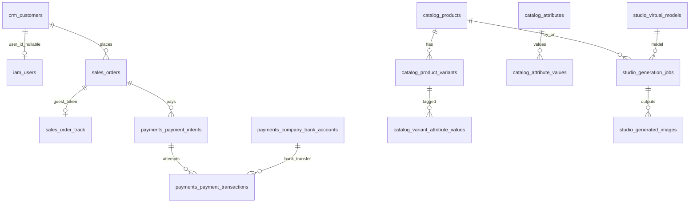

# Sabu Expansion — ERD Gaps & Relationships

## Existing core (unchanged)

- `catalog.products` → `product_variants` → `product_images`
- `pricing.price_lists` → `price_list_items` (tiered by `min_qty`, versioned by `valid_during`)
- `sales.carts` / `cart_items` → `orders` / `order_items` (price snapshots)
- `payments.payment_providers` → `payment_methods` → `payment_intents` → `payment_transactions` → `webhook_events`
- `notify.*`, `inventory.stock_balances` / `stock_reservations`, `iam.*`, `crm.customers`

## Additive entities

## Column / table changes

| Object | Change |
|--------|--------|
| `crm.customers` | `user_id` nullable; `is_guest`; `first_name`; `last_name`; `phone_e164` |
| `sales.orders` | `guest_track_token_hash`; `guest_phone_e164` |
| `payments.company_bank_accounts` | **new** |
| `payments.payment_transactions` | `company_bank_account_id`; `customer_reference`; `rejection_reason` |
| `catalog.products` | `bulk_purchasing_enabled` |
| `catalog.attributes` (+ values, variant link) | **new** |
| `studio.*` | **new schema** |

## Pricing note

Do **not** add a parallel `product_prices` table. Continue using `pricing.price_list_items` with retail/wholesale lists and `min_qty` tiers. Historical prices = closed ranges + order line snapshots.
